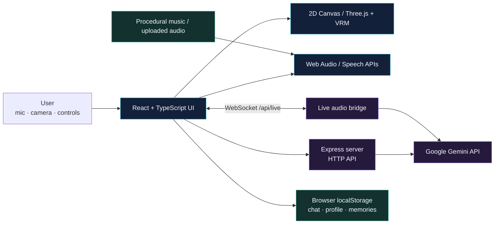

<!-- AI-WIFU README: current repository guide and project status. -->

<p align="center">
  
</p>

<p align="center">
  
  
  
  
  
</p>

<h1 align="center">AI-WIFU</h1>

<p align="center">
  <strong>An interactive anime companion experience built around live voice, expressive animation, and personalization.</strong>
  <br />
  A React + TypeScript client, an Express API server, WebSocket audio streaming, and a Three.js / VRM avatar layer.
</p>

<p align="center">
  <a href="#-what-is-ai-wifu">Overview</a> ·
  <a href="#-experience-features">Features</a> ·
  <a href="#-system-architecture">Architecture</a> ·
  <a href="#-run-locally">Run locally</a> ·
  <a href="#-privacy-security-and-known-limitations">Privacy & limitations</a>
</p>

---

## ✦ What is AI-WIFU?

**AI-WIFU is a full-stack prototype for an expressive, voice-enabled anime companion.** It combines AI chat, live audio conversations, optional camera-based vision, avatar animation, customization, music, snapshots, and a browser-stored memory profile in one interactive interface.

The visual direction is a futuristic companion console: dark surfaces, holographic accents, animated feedback, and a character that reacts to listening, speaking, music, and user interactions. The goal is to connect these systems into one experience rather than present a plain chat window.

> **Project status: prototype.** The repository contains substantial UI and integration code, but that is not proof that every external AI endpoint, voice model, music-generation model, browser API, or deployment configuration will work in every environment. Provider model access, quotas, billing, and availability can change. The illustration above is concept art, not a screenshot of the application.

## ◈ Experience features

| Capability | What the current code is built to do |
|---|---|
| **Character presets** | Switch among six built-in character profiles, each with its own personality, voice defaults, appearance, and starter prompts. |
| **Avatar engines** | Render an animated 2D canvas character or a Three.js-based 3D VRM avatar. The 3D path includes custom VRM file upload via [`VRMCharacterCanvas.tsx`](src/components/VRMCharacterCanvas.tsx). |
| **Live voice conversation** | Connect to a backend WebSocket at `/api/live` and bridge microphone audio to Gemini Live; receive audio chunks and transcription events. |
| **Chat with generated voice** | Send character-aware chat requests through the Express API, with server-side Gemini calls and a graceful fallback response path. |
| **Speech modes** | Use browser speech recognition / recording fallbacks and optional Gemini transcription and text-to-speech endpoints. |
| **Expressions and lip sync** | Drive emotion states, mouth visemes, speaking/listening/thinking indicators, reactions, and selected avatar gestures. |
| **Camera vision** | Capture a camera frame or use an image for a vision request; a floating live-camera panel is also provided. |
| **Wardrobe and environments** | Adjust supported hair and eye colors, hair styles, outfits, accessories, and background scenes. |
| **Music and audio** | Play procedural built-in lo-fi / anime-synth tracks, upload a local audio file, visualize audio frequencies, and use the optional Lyria generation endpoint. |
| **Memory core** | Manage a user profile, nickname, notes, categorized facts, and conversation memory stored in the browser's local storage via [`memoryEngine.ts`](src/services/memoryEngine.ts). |
| **Companion progress** | Track an affection/bond score, interaction counts, call history, and related UI feedback. |
| **Snapshots** | Capture and preview a companion snapshot through the app's snapshot interface. |

Some items depend on browser permissions or live external APIs; see [Configuration](#-configuration) and [Privacy, security, and known limitations](#-privacy-security-and-known-limitations).

## ◇ System architecture

The application is served as a single full-stack process during local development. Vite provides the frontend, Express handles API routes, and a Node WebSocket server bridges live microphone audio to the Gemini Live API.



### Main technologies

| Layer | Technology | Location |
|---|---|---|
| UI | React 19, TypeScript, Tailwind CSS 4, Motion, Lucide | `src/` |
| Build and dev server | Vite 6, React plugin, Tailwind Vite plugin | [`vite.config.ts`](vite.config.ts), [`package.json`](package.json) |
| HTTP backend | Express 4, Node.js, dotenv | [`server.ts`](server.ts) |
| Live audio transport | `ws` WebSocket server and browser WebSocket client | [`server.ts`](server.ts), [`geminiLiveClient.ts`](src/services/geminiLiveClient.ts) |
| AI provider integration | `@google/genai` | [`server.ts`](server.ts), [`geminiService.ts`](src/services/geminiService.ts) |
| 3D avatar rendering | Three.js, `@pixiv/three-vrm`, GLTF loader | [`VRMCharacterCanvas.tsx`](src/components/VRMCharacterCanvas.tsx) |
| Local audio | Web Audio API, browser speech interfaces | [`audioEngine.ts`](src/services/audioEngine.ts), [`musicEngine.ts`](src/services/musicEngine.ts) |
| Local memory | Browser `localStorage` | [`memoryEngine.ts`](src/services/memoryEngine.ts), [`App.tsx`](src/App.tsx) |

### Request and data flow

1. The React app manages character selection, UI, interaction state, and camera / microphone permission requests.
2. Ordinary AI features call Express endpoints such as `/api/chat-with-voice`, `/api/vision`, and `/api/tts`.
3. Live conversations use the `/api/live` WebSocket, which creates a Gemini Live session and forwards audio plus available transcription/interruption events.
4. The avatar layer maps app state to motion, facial expressions, and mouth animation.
5. Profile, selected chat history, memory facts, and selected progress values persist in browser storage. They are not a server-side account or cloud sync system.

## ⚙️ Run locally

### Prerequisites

- **Node.js** compatible with the dependencies (Node 20 or newer is a sensible starting point).
- Bun or npm for dependency installation. The repository includes a `bun.lock` file; Bun is the recommended path for preserving the checked-in lockfile.
- A Google Gemini API key for provider-powered features.
- A modern browser with JavaScript, Web Audio, and supported speech / media APIs. Microphone and camera capture generally require a secure browser context such as `localhost` or HTTPS; see [MDN: getUserMedia](https://developer.mozilla.org/en-US/docs/Web/API/MediaDevices/getUserMedia).

### 1. Clone the repository

```bash
git clone https://github.com/Rishidev-20thcenturey/AI-WIFU-.git
cd AI-WIFU-
```

### 2. Install dependencies

**Recommended with Bun:**

```bash
bun install
```

**Or use npm:**

```bash
npm install
```

### 3. Configure the Gemini API key

Copy the environment template:

```bash
cp .env.example .env
```

On Windows PowerShell:

```powershell
Copy-Item .env.example .env
```

Open `.env` and replace the placeholder with a real API key:

```dotenv
GEMINI_API_KEY=replace_with_your_own_key
```

Keep the key private. The project’s `.gitignore` excludes environment files while allowing `.env.example`. Do not commit a real credential, put a privileged key in client-side source code, or publish screenshots that reveal the key.

The template also contains `APP_URL`, inherited from the AI Studio setup. At the current revision, `server.ts` does not read `APP_URL`; it binds to port `3000` directly.

### 4. Start the full-stack development server

With Bun:

```bash
bun run dev
```

Or with npm:

```bash
npm run dev
```

Open [http://localhost:3000](http://localhost:3000).

Check the backend health endpoint at [http://localhost:3000/api/health](http://localhost:3000/api/health). The response reports the server status and whether `GEMINI_API_KEY` is present. This confirms configuration visibility, not that every external model call succeeds.

### 5. Build and start the production bundle

```bash
bun run build
bun run start
```

The build script runs `vite build` and bundles `server.ts` to `dist/server.cjs`; the start script launches that Node server. Use the full-stack start command for API and WebSocket functionality. `vite preview` is a frontend preview server, not a replacement for the Express + WebSocket application server.

### Useful commands

| Command | Purpose |
|---|---|
| `bun run dev` | Start Express and Vite in development mode |
| `bun run lint` | Run TypeScript checking with `tsc --noEmit` |
| `bun run build` | Build the frontend and bundle the Node server |
| `bun run start` | Start the built full-stack server |
| `bun run preview` | Preview the Vite frontend bundle only |
| `bun run clean` | Remove `dist` and the legacy `server.js` output |

The available scripts are listed in [`package.json`](package.json). The package currently defines **no dedicated `test` script**. `lint` is a TypeScript check, not a unit or end-to-end test suite. Build and lint commands are documented from the checked-in scripts; their success is not asserted by this README.

## 🔌 Backend API surface

The following routes are defined in [`server.ts`](server.ts). They are integration entry points, not a promise that all model IDs remain enabled by the provider.

| Method / protocol | Path | Purpose |
|---|---|---|
| HTTP GET | `/api/health` | Basic server status and API-key-presence indicator |
| HTTP POST | `/api/chat-with-voice` | Character-aware chat response, optional image context, and generated speech |
| HTTP POST | `/api/transcribe-audio` | Transcribe a provided audio recording |
| HTTP POST | `/api/extract-memory` | Extract a possible personal memory fact from text |
| HTTP POST | `/api/consolidate-call-memory` | Summarize a call and return candidate new facts / name preferences |
| HTTP POST | `/api/generate-music` | Optional Lyria-based music-generation request |
| HTTP POST | `/api/tts` | Generate speech audio from text |
| HTTP POST | `/api/vision` | Analyze a submitted image frame |
| WebSocket | `/api/live` | Live voice session and audio / transcription event bridge |

The current backend code references several Gemini model identifiers, including live-audio, TTS, transcription, chat, and Lyria preview variants. These identifiers are hardcoded in source; confirm current provider access, model availability, usage limits, and billing before relying on them.

## 🗂️ Project layout

```text
.
├── assets/
│   └── ai-wifu-hero.svg            # Custom README illustration
├── public/                         # Static images and character/background assets
├── src/
│   ├── components/                 # Avatar, HUD, modals, wardrobe, camera, music
│   ├── data/
│   │   ├── characters.ts           # Character presets and appearance defaults
│   │   └── sceneries.ts            # Background scene definitions
│   ├── services/
│   │   ├── geminiService.ts        # HTTP calls and fallbacks
│   │   ├── geminiLiveClient.ts     # Browser live audio WebSocket client
│   │   ├── audioEngine.ts          # Voice playback and audio effects
│   │   ├── musicEngine.ts          # Procedural music and uploaded audio
│   │   └── memoryEngine.ts         # Browser memory profile
│   ├── utils/
│   │   └── proceduralAnimeAvatar.ts
│   ├── App.tsx                     # Main app state and feature wiring
│   ├── main.tsx                    # React application entry point
│   ├── index.css                   # Global cyber-HUD styling
│   └── types.ts                    # Shared domain types
├── server.ts                       # Express APIs, Gemini calls, /api/live WS
├── index.html                      # Browser title and metadata
├── metadata.json                   # AI Studio project metadata
├── package.json                    # Scripts and dependencies
├── bun.lock                        # Bun dependency lockfile
├── .env.example                    # Environment variable template
├── tsconfig.json
└── vite.config.ts
```

## 🛡️ Privacy, security, and known limitations

AI-WIFU is a prototype. Review these constraints before running it with real personal data or making it publicly accessible.

### Personal data and browser storage

- Chat history, memory facts, nickname/profile values, and selected progress fields are saved to browser `localStorage`. They can persist across reloads on the same browser profile and are not encrypted by this app.
- The memory feature can send conversation text to Gemini for fact extraction and call-memory consolidation. Camera frames, user-submitted images, audio, and prompts can also be sent to the configured provider when those features are used.
- Only enable camera, microphone, and continuous listening when needed. Review memory entries and clear data from the app or the browser when appropriate.
- Use the provider's current privacy terms to understand how submitted data is handled. Avoid transmitting passwords, authentication tokens, confidential work data, or other highly sensitive information.

### API-key handling

- The preferred full-stack path reads `GEMINI_API_KEY` on the server.
- A client-side fallback in `src/services/geminiService.ts` can read `GEMINI_USER_API_KEY` from browser storage in some hosting/error paths. A key available to frontend code is exposed to that browser environment; do not treat it as a server secret.
- API routes in `server.ts` do not show an application authentication layer or a general request rate limiter. Do **not** expose this backend to the public internet with a valuable API key until you have added appropriate access controls, quotas/rate limits, request validation, logging, and deployment hardening.
- The JSON request body limit is set to 20 MB; that alone is not comprehensive request or abuse protection.

### Deployment and compatibility

- **Port binding:** `server.ts` currently uses port `3000` rather than reading `process.env.PORT`. Platforms that inject a required port (for example, some container hosts) may need a small server configuration change before deployment.
- **External API dependence:** model IDs, preview endpoints, API access, quotas, region availability, and billing can change. A fallback response does not mean the requested AI service worked.
- **Browser capabilities:** live audio, speech recognition, camera access, and WebSocket behavior depend on browser support, user permissions, secure context, and the hosting environment.
- **Not a production service:** the repo does not include a documented production security review, service-level objectives, or a dedicated automated test suite.
- **No license file is currently present:** do not assume an open-source license or reuse permissions have been granted until a license is added and reviewed.
- **No account-backed cloud sync:** the memory engine is browser-storage based; clearing site data or switching browser profiles can remove or isolate local state.

## 🧭 Practical next steps

For a reliable next iteration, prioritize engineering safety alongside presentation:

1. Make the runtime port configurable for hosting environments.
2. Add authentication or access restrictions and rate limiting before public deployment.
3. Add automated API / UI tests for chat, vision, memory, live audio reconnects, and browser-permission failure paths.
4. Add explicit memory export/delete controls and a concise data-flow notice in the app UI.
5. Pin and verify the AI model identifiers used by each provider route, with clear fallbacks for unavailable services.
6. Add a license and document supported deployment targets only after they are verified.

## Contributing

Focused issues and pull requests are welcome. Please include the affected feature, a minimal reproduction, expected vs. actual behavior, browser/runtime details, and relevant logs. Never include API keys, private audio/images, or unredacted environment files in issues.

---

<p align="center">
  <strong>Build an expressive companion. Keep the engineering transparent.</strong>
  <br />
  <sub>AI-WIFU · Live voice · Avatar animation · Personalization</sub>
</p>
